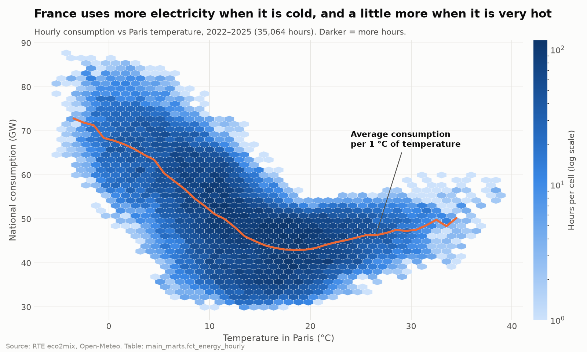

# energy-dbt

A small, reproducible data pipeline that joins French national electricity consumption (RTE eCO2mix) with Paris temperature (Open-Meteo) using DuckDB and dbt, to see how weather drives demand. It is a learning project: every model states its grain and unique key, and the data decisions are written down below.

**Key finding.** Hourly consumption moves with temperature: the correlation is **-0.61** with temperature and **+0.70** with heating degrees (degrees below 18 °C), over 35,064 hours from 2022 to 2025. Consumption rises steeply as it gets colder (heating) and rises a little in extreme heat (air conditioning), with a minimum around 15-20 °C.



## Lineage

```
raw.load ────► stg_eco2mix__load ───► int_load_hourly ──┐
                                                         ├─► fct_energy_hourly ─► chart
raw.weather ─► stg_open_meteo__weather ──────────────────┘
```

| Model | Layer | Grain (one row is...) | Unique key |
|---|---|---|---|
| `stg_eco2mix__load` | staging (view) | one 15-minute slot of the eCO2mix file | `observed_at` |
| `stg_open_meteo__weather` | staging (view) | one hour of Paris temperature | `observed_at` |
| `int_load_hourly` | intermediate (view) | one UTC hour, gap-free, 2011-12-31 23:00 to 2026-01-01 22:00 | `hour_utc` |
| `fct_energy_hourly` | mart (table) | one UTC hour with both consumption and temperature, 2022-2025 (35,064 rows) | `hour_utc` |

The raw schema is loaded by `scripts/load_raw.py` and is never modified by dbt. dbt writes to the schemas `main_staging`, `main_intermediate` and `main_marts`.

## Data decisions and why

- **Everything in UTC.** Local time has 23- and 25-hour days around the clock changes, which breaks hourly series and joins. Timestamps are converted to UTC early; only the calendar columns in the mart (`local_hour`, `local_day_of_week`, `local_month`, `is_weekend`) use Paris time, because people live on the local clock.
- **56 phantom spring-forward rows removed in staging.** On spring-forward days the source has rows labelled `02:xx` (an hour that does not exist) carrying the `03:xx` timestamp, so `Date et Heure` is not unique. Staging keeps the row whose local clock time matches its own timestamp. Consequence: the `02:xx` values on those mornings are discarded, and a few differ slightly from the `03:xx` ones.
- **14 missing October hours filled by linear interpolation.** The source has no readings for 00:00-00:59 UTC on each October clock-change day (14 days from 2012 to 2025; 4 fall inside the mart's 2022-2025 range). `int_load_hourly` builds a complete hourly spine, left-joins the data and interpolates between neighbours. Every filled row has `is_imputed = true`, so it can be excluded or audited. Nothing is extrapolated beyond the first and last real hour.
- **Hourly value = mean of the available readings in the hour** (usually the :00 and :30 readings; real actuals only exist at :00 and :30, the :15/:45 slots are empty).
- **`ND` loaded as NULL.** The eCO2mix file contains the text `ND` in two numeric columns (17,570 times in `Gaz - Cogénération (MW)`, 28 times in `Ech. comm. Allemagne-Belgique (MW)`). They are loaded as `NULL` so the columns stay numeric. That `ND` means "non disponible" is an **assumption not yet verified** against RTE's documentation.
- **Inner join in the mart.** The weather only covers 2022-2025, so the mart keeps only hours present on both sides. The mart's purpose is to relate temperature to consumption, so rows without temperature are of no use there. A test checks the mart has exactly as many rows as the weather table.
- **18 °C heating threshold.** `heating_degrees_c = max(18 - temperature, 0)`. 18 °C is a common convention for where heating starts, not something derived from this data. It is an assumption you can change in `models/marts/fct_energy_hourly.sql`.

## Setup from a fresh clone

Requires Python 3 (developed with 3.13) and about 150 MB of free disk for the data and database.

```bash
git clone https://github.com/<your-user>/energy-dbt.git
cd energy-dbt

# 1. Python environment
python3 -m venv .venv
source .venv/bin/activate
pip install -r requirements.txt

# 2. Source data (not in git). Follow data/README.md for the two files and their exact names:
#      data/eco2mix-national-cons-def.csv
#      data/open-meteo-48.85N2.36E43m.csv

# 3. Load the raw schema into energy.duckdb (checks row counts: 491,040 and 35,064)
python scripts/load_raw.py

# 4. Build all models and run all 27 tests
dbt build --profiles-dir .

# 5. Regenerate the chart (writes analysis/consumption_vs_temperature.png)
python analysis/plot_consumption_vs_temperature.py
```

DuckDB lets only one process open `energy.duckdb` at a time. If a command fails with "Could not set lock", close any other duckdb shell and try again.

`scripts/load_raw.py` is idempotent (rerunning rebuilds the tables, it never appends), and exits with an error if the row counts differ, which usually means a wrong or truncated download.

## Checks

`dbt build` runs 27 checks: `unique` and `not_null` on every key, `relationships` and `accepted_values` where relevant, and three custom tests in `tests/` (no missing hours in the weather staging model, no missing hours in `int_load_hourly`, and mart row count equals weather row count).

## Known limitations and next steps

Limitations:
- Weather is for **Paris only**, while consumption is national, so temperature explains consumption only partly (the cloud of points in the chart is wide).
- A correlation is not a causal model; hour of day, weekday and holidays also matter and are not modelled.
- The `ND` meaning and the download URLs in `data/README.md` are unverified.
- RTE revises its "consolidées" data: a newer download may have different counts, and the script will stop to tell you.
- Staging keeps a subset of the eCO2mix columns (it drops the fuel sub-breakdowns such as `Gaz - CCG`).
- The load history before 2022 and the last day (2026-01-01) are not in the mart.

Next steps:
- Weight several cities' temperatures by population, or use a national temperature index.
- Add a chart by hour of day and weekday vs weekend, and a simple regression of consumption on heating degrees.
- Add a source freshness check and run `dbt build` in CI.
